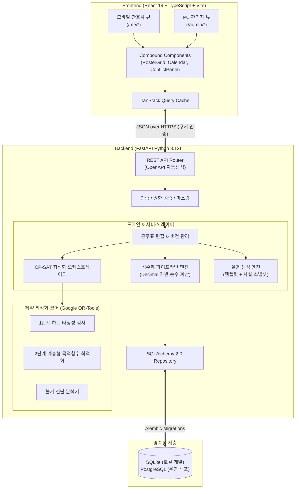
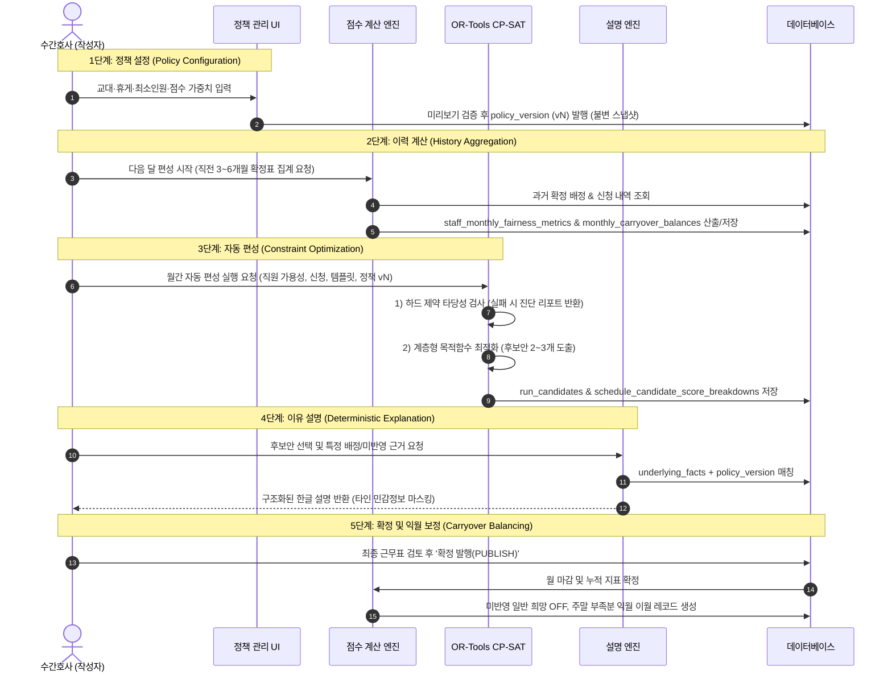

# 시스템 아키텍처 설계 (ARCHITECTURE)

> 상태: **Phase 0 확정 v0.1** · 근거: [MASTER_PROMPT.md](../MASTER_PROMPT.md) §1, §6, §10, §11

---

## 1. 시스템 개요 및 구성도

산부인과 병동 근무 스케줄러는 결정론적 제약 최적화(CP-SAT), 명확한 수식 기반 점수제, 그리고 재현 가능한 편성 설명 엔진을 갖춘 클라이언트-서버 웹 애플리케이션이다.



---

## 2. 5단계 데이터 처리 파이프라인

MASTER_PROMPT §6-4A E에 규정된 5단계 파이프라인을 엄격히 구현한다. 정책 외의 숨겨진 AI 임의 결정은 전면 배제된다.



---

## 3. 제약 최적화 엔진 (OR-Tools CP-SAT) 모델링

### 3-1. 변수 정의
- **결정 변수 $X_{s, d, t} \in \{0, 1\}$**: 간호사 $s \in S$, 일자 $d \in D$, 근무 템플릿 $t \in T$에 배정되면 1, 아니면 0.
- **보조 변수 $W_{s, d} \in \{0, 1\}$**: 간호사 $s$가 일자 $d$에 실제 근무(Day 또는 Night 등)를 수행하면 1, OFF이면 0.

### 3-2. 하드 제약 수식화 (Hard Constraints)
1. **일일 단일 배정 제약 (H-OVERLAP):**
   $$\sum_{t \in T} X_{s, d, t} \le 1 \quad \forall s \in S, \forall d \in D$$
2. **최소 인원 커버리지 제약 (H-COV):**
   $$\sum_{s \in S} X_{s, d, t} \ge \text{MinStaff}(d, t) \quad \forall d \in D, \forall t \in T$$
3. **필수 역량 커버리지 제약 (H-SKILL):**
   $$\sum_{s \in S, \text{hasSkill}(s, k)} X_{s, d, t} \ge \text{MinSkillStaff}(d, t, k) \quad \forall d \in D, \forall t \in T, \forall k \in K$$
4. **승인된 휴가 준수 (H-LEAVE):**
   $$X_{s, d, t} = 0 \quad \forall (s, d) \in \text{ApprovedLeaves}, \forall t \in T$$
5. **최소 휴식 시간 보장 (H-REST, 11시간 = 660분):**
   만약 근무 $t_1$ 종료 시각과 다음 근무 $t_2$ 시작 시각 사이의 휴식 간격이 660분 미만인 경우:
   $$X_{s, d_1, t_1} + X_{s, d_2, t_2} \le 1$$
   *(예: 2교대 N(18~08) 다음 날 D(08~18)는 간격 0h로 금지, N 다음 날 N(18~08)은 간격 10h로 금지)*
6. **최대 연속 근무 상한 (H-CONSEC, 기본 5일):**
   $$\sum_{i=0}^{5} W_{s, d+i} \le 5 \quad \forall s \in S, \forall d \le |D|-5$$
7. **주당 실근로시간 상한 (H-WEEK, 52시간 = 3,120분):**
   $$\sum_{i=0}^{6} \sum_{t \in T} \text{ActualMinutes}(t) \cdot X_{s, d+i, t} \le 3120 \quad \forall s \in S, \forall d \le |D|-6$$
8. **전월 말 경계월 조건 (H-BOUNDARY):**
   $d=1$ 직전의 전월 말 배정 $X_{s, 0, t}$ 및 $X_{s, -1, t}$ 데이터를 고정 상수로 주입하여 $d=1, 2$의 휴식 및 연속 근무를 연속적으로 검증.

### 3-3. 계층형 목적함수 (Hierarchical Soft Objectives)
솔버는 가중 합산(Weighted Sum) 방식을 사용하되, 계층별 가중치 스케일을 차등 적용한다.
$$\text{Maximize} \quad Z = \alpha \cdot \text{Obj}_{\text{Req}} - \beta \cdot \text{Obj}_{\text{Fairness}} - \gamma \cdot \text{Obj}_{\text{NightWeekend}} - \delta \cdot \text{Obj}_{\text{Fatigue}}$$

- **$\text{Obj}_{\text{Req}}$ (적격 희망 OFF 반영):**
  신청자 $s$의 일자 $d$ 희망 오프 충족 시 $\text{PriorityPoints}(s, d)$ 만큼 가산.
- **$\text{Obj}_{\text{Fairness}}$ (부담 점수 편차):**
  $$\sum_{s \in S} |\text{ActualBurden}_s - \text{ExpectedBurden}_s|$$
- **$\text{Obj}_{\text{NightWeekend}}$ (야간/주말 불균형):**
  간호사 간 주말 근무일 수 및 야간 근무 횟수의 최대-최소 격차 최소화.
- **$\text{Obj}_{\text{Fatigue}}$ (피로도 감소):**
  단절된 1일 OFF(근무-오프-근무) 지양, 4일 이상 연속 근무 지양.

---

## 4. '왜 이렇게 편성됐나요?' 설명 엔진 (Explanation Engine)

### 4-1. 설계 원칙
- **결정론적 근거:** 설명은 LLM이 지어내는 환각이 아니라, 솔버 입력 스냅샷과 제약 평가 결과(`explanation_facts`)에서 직접 생성한다.
- **사후 검증(Counterfactual Analysis):** "왜 A에게 나이트가 배정되었는가?"에 대해 솔버가 $X_{A, d, N}=1$을 선택한 이유를 다른 후보 $B, C$의 제약 충족 여부(휴가, 최소 휴식 위반 등)와 비교하여 팩트 기반으로 도출한다.
- **정보 마스킹:** 간호사 개인에게는 동료의 구체적인 질병/사유를 비공개하고, "필요 최소 인원 충족 및 타 근무자 자격 요건" 등의 정제된 템플릿 텍스트만 노출한다.

### 4-2. 사유 코드 (`reason_codes`) 체계
- `REQ_GRANTED`: 신청한 일반 희망 OFF가 정상 반영됨.
- `REQ_CONFLICT_PRIORITY`: 동일 날짜 경합 발생. 최근 주말 부족 및 이전 미반영 점수에 의해 우선순위 결정.
- `MANDATORY_COVERAGE`: 병동 필수 최소 인원(N명) 충족을 위한 배정.
- `SKILL_REQUIREMENT`: 해당 시간대에 필요한 역량(예: 책임간호사 자격) 보유자가 본인뿐이어서 배정.
- `REST_RULE_PROTECTION`: 이전 나이트 근무 후 11시간 휴식 규정 준수를 위해 비배정(오프).
- `CONSECUTIVE_LIMIT`: 5일 연속 근무 상한 도달에 따른 강제 휴식 배정.

---

## 5. 프론트엔드 아키텍처 및 스킬 적용

### 5-1. 디렉토리 구조
```
frontend/src/
├── api/                   # OpenAPI 클라이언트 및 TanStack Query 훅
├── app/                   # 라우팅 (React Router v6/v7) 및 전역 레이아웃
├── components/            # 재사용 컴포넌트 (Vercel Composition Patterns 적용)
│   ├── ui/                # Button, Input, Modal, Badge, BottomSheet 등 기본 UI
│   ├── Calendar/          # 모바일/PC 겸용 캘린더 컴포넌트
│   ├── RosterGrid/        # 월간 31일 x N명 고성능 매트릭스 그리드
│   ├── ShiftCell/         # 색상 토큰 + 텍스트 레이블 교대 칩
│   ├── RequestCard/       # 오프 신청 카드
│   └── ConflictPanel/     # 충돌 해결 및 사유 설명 패널
├── features/              # 도메인 기능 모듈
│   ├── my-schedule/       # [우선화면 1] 간호사 내 근무표
│   ├── requests/          # [우선화면 2] 오프 신청 및 내역
│   ├── roster-editor/     # [우선화면 3] 관리자 전체 근무표 편집기
│   ├── conflicts/         # [우선화면 4] 오프 충돌 해결
│   ├── auto-schedule/     # [우선화면 5] 자동 편성 및 후보안 비교
│   ├── staff-admin/       # [우선화면 6] 인력 관리
│   ├── policy-admin/      # [우선화면 6] 근무 정책 관리
│   └── fairness/          # 공정성 통계 및 지표
├── styles/                # CSS 변수 토큰 및 전역 스타일
└── tokens/                # 컬러, 간격, 타이포그래피 상수
```

### 5-2. 고성능 그리드 렌더링 최적화
- `RosterGrid`는 한 달 31일 × 6~20명의 셀을 렌더링한다.
- `vercel-react-best-practices`의 `rerender-memo`, `js-index-maps` 규칙을 적용하여 `(staffId, date)` 배정 룩업을 Map으로 $O(1)$ 처리하고, 단일 셀 편집 시 전체 행이나 그리드가 불필요하게 리렌더링되지 않도록 셀 단위 Memoization을 구현한다.
- 가로 스크롤은 전체 페이지 스크롤을 발생시키지 않고 표 컨테이너 내부 스크롤로 가두며, 좌측 직원명 열과 상단 날짜 행은 `position: sticky`로 고정한다.
