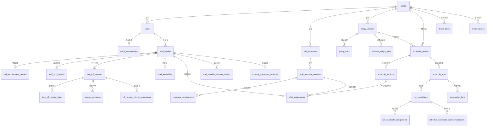

# 데이터 모델 설계 (DATA_MODEL)

> 상태: **Phase 0 확정 v0.1** · 근거: [MASTER_PROMPT.md](../MASTER_PROMPT.md) §5, §6-4A, §9
> 이 설계는 정규화와 불변 이력 보존 원칙을 따르며, 근무 템플릿·커버리지·점수 가중치를 특정 열로 하드코딩하지 않는다.

---

## 1. 핵심 설계 원칙

1. **시간 분리:** 배정(Assignment)은 `start_at_utc`, `end_at_utc` (UTC Timestamp)와 현지 시작 일자 `local_start_date` (Date, YYYY-MM-DD)를 분리하여 저장한다.
2. **정책 및 템플릿의 버전 관리:** 근무 정의와 정책은 수정 시 과거 데이터를 덮어쓰지 않고 새로운 버전을 발행(`policy_versions`, `shift_template_versions`)하며, 확정된 근무표는 당시의 버전 ID를 FK로 참조한다.
3. **점수 분리:** 근무 부담 점수(`work_burden_points`), 오프 경합 점수(`off_priority_points`), 편성안 공정성 품질 지수(`fairness_score`)를 별도 테이블 및 컬럼으로 엄격히 분리한다.
4. **부동소수점 방지:** 점수 및 통계 수치는 `NUMERIC(10, 2)` 또는 `DECIMAL` 타입을 사용하고 반올림은 `ROUND_HALF_UP`으로 고정한다.
5. **민감정보 원천 배제:** 환자 정보, 주민등록번호, 민감한 개인 질병/사유 등은 컬럼 자체를 생성하지 않는다.

---

## 2. 엔터티 관계도 (ERD)

---

## 3. 테이블 명세

### 3-1. 조직 및 계정

#### `wards` (병동)
| 컬럼 | 타입 | 제약 조건 | 설명 |
|---|---|---|---|
| `id` | UUID / INT | PK | 고유 식별자 |
| `name` | VARCHAR(100) | NOT NULL | 병동 명칭 (예: 산부인과 병동) |
| `timezone` | VARCHAR(50) | NOT NULL DEFAULT 'Asia/Seoul' | 기준 시간대 |
| `status` | VARCHAR(20) | NOT NULL DEFAULT 'ACTIVE' | ACTIVE / INACTIVE |
| `created_at` | TIMESTAMP WITH TIME ZONE | NOT NULL | 생성 일시 |
| `updated_at` | TIMESTAMP WITH TIME ZONE | NOT NULL | 수정 일시 |

#### `users` (계정)
| 컬럼 | 타입 | 제약 조건 | 설명 |
|---|---|---|---|
| `id` | UUID / INT | PK | 사용자 식별자 |
| `login_id` | VARCHAR(50) | UNIQUE, NOT NULL | 로그인 아이디 |
| `password_hash` | VARCHAR(255) | NOT NULL | Argon2 해시 |
| `role` | VARCHAR(20) | NOT NULL | NURSE, SCHEDULER, ADMIN |
| `status` | VARCHAR(20) | NOT NULL DEFAULT 'ACTIVE' | ACTIVE, SUSPENDED |
| `created_at` | TIMESTAMP WITH TIME ZONE | NOT NULL | 가입 일시 |

#### `ward_memberships` (병동 소속)
| 컬럼 | 타입 | 제약 조건 | 설명 |
|---|---|---|---|
| `id` | UUID / INT | PK | |
| `ward_id` | FK(wards.id) | NOT NULL | |
| `user_id` | FK(users.id) | NOT NULL | |
| `role` | VARCHAR(20) | NOT NULL | 병동 내 역할 |
| `effective_from` | DATE | NOT NULL | 소속 시작일 |
| `effective_to` | DATE | NULL | 소속 종료일 |

#### `staff_profiles` (간호사 프로필)
| 컬럼 | 타입 | 제약 조건 | 설명 |
|---|---|---|---|
| `id` | UUID / INT | PK | 식별자 |
| `user_id` | FK(users.id) | UNIQUE, NOT NULL | 연동 계정 |
| `display_name` | VARCHAR(50) | NOT NULL | 화면 표시용 이름 |
| `staff_code` | VARCHAR(50) | NOT NULL | 사번 대체 식별자 |
| `active_status` | VARCHAR(20) | NOT NULL DEFAULT 'ACTIVE' | ACTIVE, ON_LEAVE, RETIRED |
| `joined_on` | DATE | NOT NULL | 입사일 |
| `left_on` | DATE | NULL | 퇴사일 |

#### `staff_employment_periods` (고용 및 근무조건 이력)
| 컬럼 | 타입 | 제약 조건 | 설명 |
|---|---|---|---|
| `id` | UUID / INT | PK | |
| `staff_id` | FK(staff_profiles.id) | NOT NULL | |
| `ward_id` | FK(wards.id) | NOT NULL | |
| `employment_type` | VARCHAR(30) | NOT NULL | FULL_TIME, SHIFT, NIGHT_ONLY, PART_TIME |
| `target_work_minutes_per_period`| INT | NOT NULL DEFAULT 9600 | 월 기준 목표 근로시간 (분 단위, 예: 160시간=9600분) |
| `can_work_night` | BOOLEAN | NOT NULL DEFAULT TRUE | 야간 근무 가능 여부 |
| `effective_from` | DATE | NOT NULL | 적용 시작일 |
| `effective_to` | DATE | NULL | 적용 종료일 |

#### `skills` (역량 태그)
| 컬럼 | 타입 | 제약 조건 | 설명 |
|---|---|---|---|
| `id` | UUID / INT | PK | |
| `code` | VARCHAR(50) | UNIQUE, NOT NULL | CHARGE_CAPABLE, DELIVERY_ROOM 등 |
| `label` | VARCHAR(100) | NOT NULL | 책임간호사 가능, 분만실 전담 등 |

#### `staff_skill_periods` (직원 보유 역량 이력)
| 컬럼 | 타입 | 제약 조건 | 설명 |
|---|---|---|---|
| `id` | UUID / INT | PK | |
| `staff_id` | FK(staff_profiles.id) | NOT NULL | |
| `skill_id` | FK(skills.id) | NOT NULL | |
| `proficiency_level` | VARCHAR(20) | DEFAULT 'COMPETENT' | 숙련도 |
| `valid_from` | DATE | NOT NULL | 유효 시작일 |
| `valid_to` | DATE | NULL | 유효 만료일 |

---

### 3-2. 근무 템플릿 및 휴게 정책

#### `shift_templates` (교대 템플릿 마스터)
| 컬럼 | 타입 | 제약 조건 | 설명 |
|---|---|---|---|
| `id` | UUID / INT | PK | |
| `ward_id` | FK(wards.id) | NOT NULL | |
| `code` | VARCHAR(20) | NOT NULL | DAY, NIGHT, EVENING 등 (자유 코드) |
| `label` | VARCHAR(50) | NOT NULL | 데이, 나이트, 이브닝 등 |
| `color_token` | VARCHAR(50) | NOT NULL | shift-day, shift-night 등 CSS 토큰 |
| `sort_order` | INT | NOT NULL DEFAULT 0 | 표시 순서 |
| `is_assignable`| BOOLEAN | NOT NULL DEFAULT TRUE | 실제 편성 가능 여부 |
| `is_active` | BOOLEAN | NOT NULL DEFAULT TRUE | 사용 여부 (소프트 삭제) |

#### `shift_template_versions` (교대 시간 버전)
| 컬럼 | 타입 | 제약 조건 | 설명 |
|---|---|---|---|
| `id` | UUID / INT | PK | |
| `shift_template_id` | FK(shift_templates.id)| NOT NULL | |
| `starts_at_local` | TIME | NOT NULL | 현지 시작 시각 (예: 08:00) |
| `ends_at_local` | TIME | NOT NULL | 현지 종료 시각 (예: 18:00) |
| `end_day_offset` | INT | NOT NULL DEFAULT 0 | 0: 당일 종료, 1: 익일 종료 |
| `break_policy_id` | FK(break_policies.id) | NULL | 연동 휴게 정책 |
| `base_burden_points`| NUMERIC(5,2) | NOT NULL DEFAULT 1.00 | 기본 근무 부담 점수 (D: 1.0, N: 2.0 등) |
| `version` | INT | NOT NULL DEFAULT 1 | 버전 번호 |
| `effective_from` | DATE | NOT NULL | |
| `effective_to` | DATE | NULL | |

#### `break_policies` (휴게 시간 정책)
| 컬럼 | 타입 | 제약 조건 | 설명 |
|---|---|---|---|
| `id` | UUID / INT | PK | |
| `ward_id` | FK(wards.id) | NOT NULL | |
| `default_break_minutes` | INT | NOT NULL DEFAULT 60 | 기본 휴게시간(분) |
| `verification_status` | VARCHAR(20) | NOT NULL DEFAULT 'UNVERIFIED' | UNVERIFIED / VERIFIED |
| `rules_json` | JSON/JSONB | NOT NULL | 시간대별 휴게 보장 세부규칙 |
| `effective_from` | DATE | NOT NULL | |
| `effective_to` | DATE | NULL | |

#### `coverage_requirements` (시간대별 필요 인원)
| 컬럼 | 타입 | 제약 조건 | 설명 |
|---|---|---|---|
| `id` | UUID / INT | PK | |
| `ward_id` | FK(wards.id) | NOT NULL | |
| `shift_template_id` | FK(shift_templates.id)| NOT NULL | |
| `scope` | VARCHAR(20) | NOT NULL | WEEKDAY, WEEKEND, HOLIDAY, ALL |
| `minimum_staff` | INT | NOT NULL DEFAULT 1 | 필요 최소 인원 |
| `effective_from` | DATE | NOT NULL | |
| `effective_to` | DATE | NULL | |

#### `coverage_skill_requirements` (필요 역량 인원)
| 컬럼 | 타입 | 제약 조건 | 설명 |
|---|---|---|---|
| `id` | UUID / INT | PK | |
| `coverage_requirement_id`| FK(coverage_requirements.id)| NOT NULL | |
| `skill_id` | FK(skills.id) | NOT NULL | |
| `minimum_staff` | INT | NOT NULL DEFAULT 1 | 필수 역량 보유 최소 인원 |

---

### 3-3. 정책 및 점수제 규격

#### `policy_versions` (정책 버전)
| 컬럼 | 타입 | 제약 조건 | 설명 |
|---|---|---|---|
| `id` | UUID / INT | PK | |
| `ward_id` | FK(wards.id) | NOT NULL | |
| `version` | INT | NOT NULL | 1, 2, 3... |
| `status` | VARCHAR(20) | NOT NULL | DRAFT, PUBLISHED, ARCHIVED |
| `created_by` | FK(users.id) | NOT NULL | 작성자 |
| `published_at` | TIMESTAMP WITH TIME ZONE | NULL | 발행 시각 |
| `effective_from` | DATE | NOT NULL | 유효 시작일 |
| `effective_to` | DATE | NULL | 유효 종료일 |

#### `policy_rules` (제약 규칙 정의)
| 컬럼 | 타입 | 제약 조건 | 설명 |
|---|---|---|---|
| `id` | UUID / INT | PK | |
| `policy_version_id` | FK(policy_versions.id)| NOT NULL | |
| `rule_type` | VARCHAR(50) | NOT NULL | H-REST, H-WEEK, H-CONSEC, H-NIGHT-CONSEC 등 |
| `parameter_json` | JSON/JSONB | NOT NULL | {"min_rest_minutes": 660} 등 |
| `hard_soft` | VARCHAR(10) | NOT NULL | HARD / SOFT |
| `weight` | NUMERIC(5,2) | DEFAULT 0.00 | 소프트 목적함수 가중치 |
| `legal_floor` | BOOLEAN | NOT NULL DEFAULT FALSE | TRUE일 경우 완화 불가 |
| `justification` | TEXT | NULL | 근거 조항/규정 설명 |

#### `fairness_weight_rules` (점수 가중치 규칙)
| 컬럼 | 타입 | 제약 조건 | 설명 |
|---|---|---|---|
| `id` | UUID / INT | PK | |
| `policy_version_id` | FK(policy_versions.id)| NOT NULL | |
| `metric_type` | VARCHAR(50) | NOT NULL | weekend_shift, holiday_shift, consecutive_5d, ungranted_pref 등 |
| `weight_value` | NUMERIC(8,2) | NOT NULL | +1.0, +1.5, +10.0 등 |
| `cap_value` | NUMERIC(8,2) | NULL | 상한값 (예: 주말 부족 40, 미반영 24, 초과 20) |
| `stack_mode` | VARCHAR(20) | DEFAULT 'MAX' | 주말∩공휴일 중첩 시 MAX 또는 SUM |

---

### 3-4. 오프 신청 및 처리

#### `leave_types` (휴가 종류)
| 컬럼 | 타입 | 제약 조건 | 설명 |
|---|---|---|---|
| `id` | UUID / INT | PK | |
| `ward_id` | FK(wards.id) | NOT NULL | |
| `code` | VARCHAR(30) | NOT NULL | PREFERENCE_OFF, ANNUAL_LEAVE, PROTECTED_LEAVE, UNAVAILABLE |
| `name` | VARCHAR(50) | NOT NULL | 일반 희망 OFF, 연차, 법정 보호휴가, 근무불가 |
| `category` | VARCHAR(30) | NOT NULL | PREFERENCE, STATUTORY_LEAVE, PROTECTED |
| `enabled` | BOOLEAN | NOT NULL DEFAULT TRUE | 사용 여부 |

#### `time_off_requests` (신청서)
| 컬럼 | 타입 | 제약 조건 | 설명 |
|---|---|---|---|
| `id` | UUID / INT | PK | |
| `staff_id` | FK(staff_profiles.id) | NOT NULL | 신청 간호사 |
| `ward_id` | FK(wards.id) | NOT NULL | 대상 병동 |
| `leave_type_id` | FK(leave_types.id) | NOT NULL | 신청 유형 |
| `status` | VARCHAR(20) | NOT NULL | DRAFT, SUBMITTED, UNDER_REVIEW, APPROVED, NOT_GRANTED, WITHDRAWN |
| `is_important` | BOOLEAN | NOT NULL DEFAULT FALSE | 중요 요청 여부 (월 1건 한도) |
| `reason_note` | TEXT | NULL | 사유 (민감정보 배제 권고) |
| `submitted_at` | TIMESTAMP WITH TIME ZONE | NULL | 제출 시각 |
| `reviewed_by` | FK(users.id) | NULL | 검토자 |
| `reviewed_at` | TIMESTAMP WITH TIME ZONE | NULL | 검토 시각 |
| `version` | INT | NOT NULL DEFAULT 1 | 낙관적 동시성 제어 |

#### `time_off_request_dates` (신청 일자)
| 컬럼 | 타입 | 제약 조건 | 설명 |
|---|---|---|---|
| `id` | UUID / INT | PK | |
| `request_id` | FK(time_off_requests.id)| NOT NULL | |
| `local_date` | DATE | NOT NULL | 희망 일자 (YYYY-MM-DD) |
| `optional_rank` | INT | DEFAULT 1 | 복수 일자 신청 시 우선순위 |
| `preferred_shift_template_id`| FK(shift_templates.id)| NULL | 선호 교대 (PREFERRED_SHIFT일 때) |

#### `off_request_priority_evaluations` (경합 우선순위 평가 결과)
| 컬럼 | 타입 | 제약 조건 | 설명 |
|---|---|---|---|
| `id` | UUID / INT | PK | |
| `request_id` | FK(time_off_requests.id)| NOT NULL | |
| `policy_version_id`| FK(policy_versions.id)| NOT NULL | 계산 당시 정책 버전 |
| `weekend_off_deficit_points`| NUMERIC(5,2) | NOT NULL | min(40, 10 × 부족횟수) |
| `ungranted_points` | NUMERIC(5,2) | NOT NULL | min(24, 8 × 미반영횟수) |
| `burden_excess_points`| NUMERIC(5,2) | NOT NULL | clamp(부담초과%, 0, 20) |
| `importance_points` | NUMERIC(5,2) | NOT NULL | 중요 요청 +10 |
| `total_priority_points`| NUMERIC(5,2) | NOT NULL | 합계 (최대 94점) |
| `evaluation_details_json`| JSON/JSONB | NOT NULL | 계산 세부 팩트 |

---

### 3-5. 근무표 편성 및 최적화 실행

#### `schedule_periods` (편성 대상 기간)
| 컬럼 | 타입 | 제약 조건 | 설명 |
|---|---|---|---|
| `id` | UUID / INT | PK | |
| `ward_id` | FK(wards.id) | NOT NULL | |
| `start_date` | DATE | NOT NULL | 편성 시작일 (예: 2026-11-01) |
| `end_date` | DATE | NOT NULL | 편성 종료일 (예: 2026-11-30) |
| `status` | VARCHAR(20) | NOT NULL DEFAULT 'PLANNING' | PLANNING, GENERATED, CONFIRMED, ARCHIVED |
| `policy_version_id`| FK(policy_versions.id)| NOT NULL | 적용 정책 버전 |
| `version` | INT | NOT NULL DEFAULT 1 | |

#### `schedule_versions` (근무표 판본)
| 컬럼 | 타입 | 제약 조건 | 설명 |
|---|---|---|---|
| `id` | UUID / INT | PK | |
| `schedule_period_id` | FK(schedule_periods.id)| NOT NULL | |
| `version_number` | INT | NOT NULL | 1 (초안), 2 (수정초안), 3 (확정본)... |
| `status` | VARCHAR(20) | NOT NULL | DRAFT, PUBLISHED, ARCHIVED |
| `parent_version_id` | FK(schedule_versions.id)| NULL | 이전 버전 참조 |
| `change_reason` | TEXT | NULL | 수동 변경 또는 재발행 사유 |
| `created_by` | FK(users.id) | NOT NULL | 작성자 |
| `published_at` | TIMESTAMP WITH TIME ZONE | NULL | 확정 발행 시각 |

#### `shift_assignments` (개별 근무 배정)
| 컬럼 | 타입 | 제약 조건 | 설명 |
|---|---|---|---|
| `id` | UUID / INT | PK | |
| `schedule_version_id` | FK(schedule_versions.id)| NOT NULL | |
| `staff_id` | FK(staff_profiles.id) | NOT NULL | |
| `shift_template_version_id`| FK(shift_template_versions.id)| NOT NULL | 근무 유형 버전 |
| `local_start_date` | DATE | NOT NULL | 현지 시작 일자 |
| `start_at_utc` | TIMESTAMP WITH TIME ZONE | NOT NULL | UTC 시작 시각 |
| `end_at_utc` | TIMESTAMP WITH TIME ZONE | NOT NULL | UTC 종료 시각 |
| `paid_work_minutes` | INT | NOT NULL | 체류시간 - 휴게시간 |
| `break_minutes` | INT | NOT NULL DEFAULT 0 | 인정 휴게시간 |
| `source` | VARCHAR(20) | NOT NULL | AUTO, MANUAL, PINNED |
| `lock_status` | BOOLEAN | NOT NULL DEFAULT FALSE | 고정(핀) 잠금 여부 |
| `note` | VARCHAR(255) | NULL | 메모 |

#### `schedule_runs` (자동 편성 실행 기록)
| 컬럼 | 타입 | 제약 조건 | 설명 |
|---|---|---|---|
| `id` | UUID / INT | PK | |
| `schedule_period_id` | FK(schedule_periods.id)| NOT NULL | |
| `policy_version_id` | FK(policy_versions.id)| NOT NULL | 실행 당시 정책 |
| `solver_version` | VARCHAR(50) | NOT NULL | OR-Tools CP-SAT v9.x 등 |
| `status` | VARCHAR(20) | NOT NULL | FEASIBLE, OPTIMAL, INFEASIBLE, TIMEOUT, FAILED |
| `seed` | INT | NOT NULL DEFAULT 42 | 재현용 시드 |
| `input_snapshot_hash` | VARCHAR(64) | NOT NULL | 입력 데이터 SHA-256 해시 |
| `diagnostics_json` | JSON/JSONB | NULL | INFEASIBLE 시 실패 원인 분석 팩트 |
| `created_by` | FK(users.id) | NOT NULL | 실행자 |
| `created_at` | TIMESTAMP WITH TIME ZONE | NOT NULL | 실행 일시 |

#### `run_candidates` (편성 후보안 2~3개)
| 컬럼 | 타입 | 제약 조건 | 설명 |
|---|---|---|---|
| `id` | UUID / INT | PK | |
| `schedule_run_id` | FK(schedule_runs.id) | NOT NULL | |
| `rank` | INT | NOT NULL | 1, 2, 3 |
| `total_score` | NUMERIC(10,2) | NOT NULL | 솔버 목적함수 원시값 |
| `fairness_score` | NUMERIC(5,2) | NOT NULL | 0~100 균형 품질 지수 |
| `fairness_metrics_json` | JSON/JSONB | NOT NULL | 부담 편차, 미반영률 등 원시 지표 |
| `coverage_metrics_json` | JSON/JSONB | NOT NULL | 인원 충족률 지표 |

#### `run_candidate_assignments` (후보안별 배정 매트릭스)
| 컬럼 | 타입 | 제약 조건 | 설명 |
|---|---|---|---|
| `id` | UUID / INT | PK | |
| `run_candidate_id` | FK(run_candidates.id) | NOT NULL | |
| `staff_id` | FK(staff_profiles.id) | NOT NULL | |
| `shift_template_version_id`| FK(shift_template_versions.id)| NOT NULL | |
| `local_start_date` | DATE | NOT NULL | |
| `start_at_utc` | TIMESTAMP WITH TIME ZONE | NOT NULL | |
| `end_at_utc` | TIMESTAMP WITH TIME ZONE | NOT NULL | |

---

### 3-6. 공정성 통계, 이월 및 설명

#### `staff_monthly_fairness_metrics` (개인별 월간 확정 통계)
| 컬럼 | 타입 | 제약 조건 | 설명 |
|---|---|---|---|
| `id` | UUID / INT | PK | |
| `staff_id` | FK(staff_profiles.id) | NOT NULL | |
| `schedule_period_id` | FK(schedule_periods.id)| NOT NULL | 대상 월 |
| `policy_version_id` | FK(policy_versions.id)| NOT NULL | 계산 당시 정책 |
| `work_burden_points` | NUMERIC(8,2) | NOT NULL | 총 근무 부담 점수 |
| `base_shift_points` | NUMERIC(8,2) | NOT NULL | 기본 교대 점수 |
| `weekend_bonus_points` | NUMERIC(8,2) | NOT NULL | 주말 추가점 |
| `holiday_bonus_points` | NUMERIC(8,2) | NOT NULL | 공휴일 추가점 |
| `consecutive_bonus_points`| NUMERIC(8,2) | NOT NULL | 연속근무 5일 도달 추가점 |
| `preference_mismatch_points`| NUMERIC(8,2) | NOT NULL | 선호 불일치 추가점 |
| `actual_work_minutes` | INT | NOT NULL | 실근로시간 (분) |
| `night_work_minutes` | INT | NOT NULL | 22~06 야간 근로시간 (분) |
| `weekend_work_minutes`| INT | NOT NULL | 주말 근로시간 (분) |
| `full_weekend_off_count`| INT | NOT NULL | 토·일 모두 근무 없는 주말 수 |
| `consecutive_work_days_max`| INT | NOT NULL | 최장 연속 근무일 수 |
| `request_grant_rate` | NUMERIC(5,4) | NULL | 적격 희망 OFF 반영률 |
| `normalized_deviation` | NUMERIC(6,4) | NOT NULL | 그룹 기대값 대비 정규화 편차 |

#### `monthly_carryover_balances` (익월 이월 잔여분)
| 컬럼 | 타입 | 제약 조건 | 설명 |
|---|---|---|---|
| `id` | UUID / INT | PK | |
| `staff_id` | FK(staff_profiles.id) | NOT NULL | |
| `period_start_date` | DATE | NOT NULL | 기준 월 |
| `weekend_off_deficit_count`| INT | NOT NULL DEFAULT 0 | 부족 주말 OFF 이월분 |
| `ungranted_preference_count`| INT | NOT NULL DEFAULT 0 | 미반영 희망 OFF 이월분 |
| `burden_excess_ratio` | NUMERIC(6,4) | NOT NULL DEFAULT 0.0000 | 정규화 부담 초과율 |
| `expires_at` | DATE | NOT NULL | 3개월 rolling 만료일 |

#### `explanation_facts` (배정 및 충돌 설명 팩트)
| 컬럼 | 타입 | 제약 조건 | 설명 |
|---|---|---|---|
| `id` | UUID / INT | PK | |
| `schedule_run_id` | FK(schedule_runs.id) | NOT NULL | |
| `subject_type` | VARCHAR(30) | NOT NULL | ASSIGNMENT, REQUEST_CONFLICT, INFEASIBLE_SLOT |
| `subject_id` | VARCHAR(50) | NOT NULL | 대상 엔터티 ID |
| `reason_code` | VARCHAR(50) | NOT NULL | COVERAGE_MIN, SKILL_MATCH, REST_VIOLATION 등 |
| `rule_version` | INT | NOT NULL | 정책 버전 |
| `fact_json` | JSON/JSONB | NOT NULL | 결정에 사용된 정량 수치 스냅샷 |
| `explanation_text` | TEXT | NOT NULL | 사람이 읽을 수 있는 한국어 설명 |

#### `audit_logs` (감사 로그)
| 컬럼 | 타입 | 제약 조건 | 설명 |
|---|---|---|---|
| `id` | UUID / INT | PK | |
| `actor_id` | FK(users.id) | NOT NULL | 변경 수행자 |
| `action` | VARCHAR(50) | NOT NULL | CREATE, UPDATE, DELETE, PUBLISH, OVERRIDE |
| `entity_type` | VARCHAR(50) | NOT NULL | ASSIGNMENT, POLICY, TIME_OFF_REQUEST |
| `entity_id` | VARCHAR(50) | NOT NULL | |
| `before_json` | JSON/JSONB | NULL | 변경 전 스냅샷 |
| `after_json` | JSON/JSONB | NULL | 변경 후 스냅샷 |
| `at_utc` | TIMESTAMP WITH TIME ZONE | NOT NULL | 변경 시각 |
| `request_ip` | VARCHAR(50) | NULL | 감사용 접근 출처 |

---

## 4. 인덱스 및 무결성 제약

1. `shift_assignments(schedule_version_id, staff_id, local_start_date)`: 고유 제약 (동일 간호사 같은 날 중복 배정 방지).
2. `shift_assignments(schedule_version_id, local_start_date)`: 날짜별 그리드 빠른 조회를 위한 B-Tree 인덱스.
3. `time_off_request_dates(local_date, request_id)`: 특정 일자 경합 요청 조회 인덱스.
4. `audit_logs(entity_type, entity_id, at_utc)`: 엔터티별 변경 이력 역추적 인덱스.
5. 낙관적 락: `time_off_requests`, `schedule_versions`에 `version` 정수 필드를 두고 변경 시 `WHERE version = :current_version` 검증.
