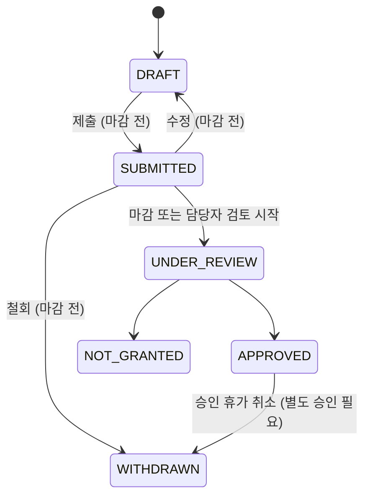

# 도메인 규칙 (DOMAIN_RULES)

> 상태: **Phase 0 초안 v0.1** · 근거: [MASTER_PROMPT.md](../MASTER_PROMPT.md) §5–§8, 부록 A
> 이 문서의 모든 수치는 **설정 가능한 기본값**이다. 코드에는 상수로 박지 않고 `policy_versions` 스냅샷에서 읽는다.
> 법령 관련 항목은 **실운영 전 병원 법무·인사 검토 필수**이며 [PRE_PRODUCTION_CHECKLIST.md](PRE_PRODUCTION_CHECKLIST.md)에 모아 둔다.

## 0. 표기 규칙

| 표기 | 의미 |
|---|---|
| `확정` | MASTER_PROMPT에 명시된 사양 (구현자가 임의로 바꾸지 않음) |
| `미확정` | 병동/병원 확인 전 기본값. UI에 **"미확정 정책"** 배지 표시, 설정 화면에서 수정 |
| `법령 후보` | 법령 근거로 보이나 적용 여부(특례업종, 노사합의 등) 확인 필요. `legal_floor=true`로 보호 |
| `해석` | MASTER_PROMPT 문장이 모호해 구현자가 해석한 것. [DECISION_LOG.md](DECISION_LOG.md)에 기록 |
| strict / conditional / advisory | 정책 강도. strict=하드, conditional=조건 충족 시 하드, advisory=경고만 |

**보호 규칙:** `legal_floor=true` 규칙은 UI·API 어디서도 `advisory`로 낮추거나 기준을 완화할 수 없다(서버 검증 + DB check). 강화(더 엄격하게)는 허용.

---

## 1. 시간 모델

### 1-1. 저장과 표시
- 병동 기본 시간대 `Asia/Seoul` (`wards.timezone`). 서머타임 없음이지만 시간대 라이브러리로 처리한다.
- 배정 저장: `start_at_utc`, `end_at_utc`(UTC instant) + `local_start_date`(현지 시작 일자). 표시는 현지 시간.
- **현지 일자(`local_date`)와 UTC instant를 섞지 않는다.** 신청·가용성은 `local_date`, 근무는 instant.

### 1-2. 시간 길이 정의 (`확정`)
```
scheduled_duration_minutes = end_at - start_at          # 체류 시간
actual_work_minutes        = scheduled_duration_minutes - verified_break_minutes
```
- D 10시간 / N 14시간을 그대로 실근로로 보지 않는다.
- `verified_break_minutes`는 `break_policies`에서 오며 `verification_status`(`UNVERIFIED`/`VERIFIED`)를 가진다. `UNVERIFIED`이면 화면에 "휴게 미확인 — 실근로시간 추정치" 표시.

### 1-3. 일자 분할 집계 (`확정`)
- **배정 횟수·부담 점수의 주말 가산:** 시작일(`local_start_date`) 기준 1회 집계 (`weekend_point_method = shift_start_day`).
- **실근로시간, 야간 시간(22:00–06:00), 주말·공휴일 시간:** 달력 일자별로 분할 집계(`overlap_minutes`).
- 예: 10/31(금) 18:00 → 11/1(토) 08:00 나이트 → 배정은 10월 1회, 야간 시간 22:00–06:00 = 8시간 중 10/31분 2시간·11/1분 6시간, 주말 시간 교집합 11/1 00:00–08:00 = 8시간(휴게 차감 전).

### 1-4. 야간근로 시간대 (`법령 후보`)
- 기본 22:00–06:00 (`night_window`). 근로기준법상 야간근로 정의로 알려져 있으나 수당 산정은 이 시스템 범위 밖(통계용 시간만 산출).

---

## 2. 근무 템플릿 (기본 샘플)

| code | label | 시작 | 종료 | end_day_offset | 체류 | 기본 휴게(분) | 할당 가능 | 상태 |
|---|---|---|---|---|---|---|---|---|
| `DAY` | 데이 (D) | 08:00 | 18:00 | 0 | 600 | 60 | 예 | 시간 `확정`(템플릿) / 휴게 `미확정` |
| `NIGHT` | 나이트 (N) | 18:00 | 08:00 | 1 | 840 | 60 | 예 | 시간 `확정`(템플릿) / 휴게 `미확정` |
| `OFF` | 오프 | – | – | – | 0 | – | 상태값 | `확정` |
| `LEAVE` | 휴가 | – | – | – | 0 | – | 상태값 (유형은 `leave_types`) | `확정` |
| `TRAINING` | 교육 | 설정 | 설정 | 설정 | 설정 | 설정 | 별도 배정 유형 | `미확정` |

- 기본 휴게 60분은 "8시간 이상 근로 시 1시간 이상 휴게"라는 법정 최소로 알려진 값을 임시로 넣은 것이다(`법령 후보`, 실제 보장 여부 `미확정`).
- **코드에 `DAY`/`NIGHT` 문자열 분기 금지.** 엔진·통계·UI는 템플릿의 속성(시간, 야간 시간 교집합, `base_burden_points`)만 사용한다. 3교대 전환 시 `EVENING` 등을 추가하고 새 정책 버전을 발행하면 그대로 동작해야 한다.
- 템플릿 필드(§5-2 확정): `code, label, start_local_time, end_local_time, ends_next_day(=end_day_offset), timezone, break_policy_id, paid_hours_formula, color_token, required_skill_tags, active_from, active_to, display_order, is_assignable`.
- 사용 중인 템플릿은 삭제 불가 → `is_active=false`(비활성).
- 과거 확정 근무표·통계는 **당시 `shift_template_versions` 스냅샷**으로 해석.

---

## 3. 하드 제약 (필수)

| ID | 규칙 | 파라미터 (기본값) | 강도 | 상태 | legal_floor |
|---|---|---|---|---|---|
| H-COV | 날짜·교대별 최소 인원 | `DAY: 1`, `NIGHT: 1` (평일/주말/공휴일 동일) | strict | `미확정` | 아니오 |
| H-SKILL | 교대별 필수 역량 최소 인원 | 없음 (예: `NIGHT`에 `CHARGE_CAPABLE` 1명) | strict | `미확정` | 아니오 |
| H-OVERLAP | 한 직원의 근무 시간 겹침 금지 | – | strict | `확정` | 예 |
| H-ELIG | 재직·소속·고용기간·자격 유효기간 내에서만 배정 | – | strict | `확정` | 예 |
| H-LEAVE | 승인된 휴가·근무불가일 배정 금지 | – | strict | `확정` | 예 |
| H-REST | 근무 종료 → 다음 근무 시작 최소 휴식 | `660`분 (11시간) | strict | `법령 후보` | 예 |
| H-WEEK | 7일 rolling 실근로시간 상한 | `3120`분 (52시간) | strict | `법령 후보` | 예 |
| H-CONSEC | 최대 연속 근무일 | `5`일 | strict | `미확정` | 아니오 |
| H-NIGHT-CONSEC | 최대 연속 나이트 | `3`회 | strict | `미확정` | 아니오 |
| H-NIGHT-MONTH | 월 나이트 상한 | 미설정 (`N/A`) | strict | `미확정` | 아니오 |
| H-OFF-MIN | 월 최소 OFF 일수 | `8`일 | conditional | `미확정` | 아니오 |
| H-PIN | 관리자가 고정(핀)한 배정 유지 | – | strict | `확정` | 아니오 |
| H-BOUNDARY | 전월 말 확정 배정을 상수로 포함, 익월 첫 7일 기존 배정과 휴식·연속 검사 | lookback 7일 / lookahead 7일 | strict | `확정` | – |
| H-NO-PHANTOM | 가상 직원 생성·중복 배정으로 커버리지 충족 금지 | – | strict | `확정` | 예 |

비고:
- **H-REST 근거 후보:** 보건업은 근로기준법 제59조 근로시간 특례업종으로 알려져 있으며, 특례 적용 시 "근로일 종료 후 다음 근로일 개시 전 연속 11시간 이상 휴식"이 요구되는 것으로 알려져 있다. 특례 미적용 시 다른 기준(주 52시간 등)이 적용된다. **병원 법무 확인 전까지 `법령 후보`.**
- **H-WEEK 근거 후보:** 주 40시간 + 연장 12시간. 특례 적용 여부에 따라 달라질 수 있음. 실근로시간(`actual_work_minutes`) 기준.
- **H-REST가 2교대에 미치는 영향 (중요):** N(18:00→익일 08:00) 종료 후 같은 날 D(08:00, 휴식 0h)·N(18:00, 휴식 10h) 모두 11시간 미만 → **나이트 다음 날은 반드시 근무 없음**. 따라서 11시간 규칙이 유지되면 N-N 연속은 불가능하며 H-NIGHT-CONSEC는 사실상 1이 된다. 엔진은 규칙을 템플릿 시간에서 계산하므로 별도 하드코딩하지 않는다.

| 연결 | 휴식 | 11h 규칙 |
|---|---|---|
| D(k) → D(k+1) | 14h | 허용 |
| D(k) → N(k) | 0h (연속 24h) | 금지 |
| D(k) → N(k+1) | 24h | 허용 |
| N(k) → D(k+1) | 0h | 금지 |
| N(k) → N(k+1) | 10h | **금지** |
| N(k) → D(k+2) | 24h | 허용 |

### 3-1. 연속 근무일 계산 기준 (`해석`, 설정 가능)
- `consecutive_basis = shift_start_day`(기본): 근무가 **시작된** 현지 일자를 근무일로 본다.
- 대안 `any_overlap_day`: 근무가 걸친 모든 일자를 근무일로 본다(나이트 1회 = 2일).
- 기본값은 MASTER_PROMPT §6-4A "시작일 기준으로 근무 배정을 한 번만 집계"와 일치시키되, 병동 결정에 따라 변경.

---

## 4. 실현가능성 사전 검사 (6명, 30일 기준)

엔진 실행 전 아래 계산을 화면에 보여주고, 불가능이 명백하면 실행 전에 경고한다(부록 A).

가정: 기본 휴게 60분 → D 실근로 9h, N 실근로 13h, H-REST 11h 적용(N 다음 날 근무 없음).

| 커버리지 (D/N) | 월 필요 배정 | 1인 평균 | 1인 점유 일수 (N은 2일) | 1인 OFF 가능일 | 1인 실근로 (주 평균) | 판정 |
|---|---|---|---|---|---|---|
| 1 / 1 | 60 | D5 + N5 | 15 | 15 | 110h (≈25.7h) | 가능 |
| 2 / 1 | 90 | D10 + N5 | 20 | 10 | 155h (≈36.2h) | 가능 (연속근무 배치 확인 필요) |
| 1 / 2 | 90 | D5 + N10 | 25 | 5 | 175h (≈40.8h) | **월 최소 OFF 8일 위반 → 불가** |
| 2 / 2 | 120 | D10 + N10 | 30 | 0 | 220h (≈51.3h) | **불가** (OFF 0일, 연속근무 상한 위반) |

- 이 표는 평균 계산일 뿐이며 실제 판정은 솔버가 한다. 표는 `INFEASIBLE` 테스트 시나리오(QA-SOL-02)의 근거로 쓴다.
- 커버리지·휴게·휴식 규칙이 `미확정`인 동안 자동 편성 결과 화면에 "미확정 정책 기준 결과" 배너를 표시한다(부록 A "성공이라고 보여주지 말 것").

---

## 5. 소프트 목표 (최적화)

계층 순서(`확정`, §6-4A D). 각 단계 안의 가중치는 정책 버전에서 공개.

| 순위 | 목표 | 측정값 |
|---|---|---|
| 1 | 적격 일반 희망 OFF 반영 (경합 우선순위 가중) | 미반영 건수 × `off_priority_points` 가중 |
| 2 | 직원별 정규화 부담 편차 최소화 | `Σ |normalized_deviation_i|`, 최대값 상한 |
| 3 | 야간·주말·공휴일 개별 편차 최소화 | 야간 분, 주말 근무일, 공휴일 근무일 편차 |
| 4 | 피로 패턴 최소화 | 장기 연속근무, 짧은 휴식 연결(하드 기준 이상이지만 정책상 피로 연결) |
| 5 | 근로시간 목표 편차 최소화 | `|actual - target|` (계약 기준시간 대비) |
| 6 | 확정본 변경 최소화 | 재편성 시 기존 확정 배정과의 차이 수 |

- **극단 불평등 방지:** 1순위만 최적화하면 특정인에게 부담이 몰릴 수 있으므로 2·3순위에 개인별 최대 편차 상한(`max_individual_deviation`, 기본 0.30 `미확정`)을 둔다.

---

## 6. 점수제 명세 (`확정` — MASTER_PROMPT §6-4A 그대로)

세 점수는 **서로 다른 값**이며 하나로 합치지 않는다.

| 점수 | 의미 | 범위 | 사용처 |
|---|---|---|---|
| `work_burden_points` | 근무 부담 | 0 이상 (상한 없음) | 공정성 지표, 정규화 편차 |
| `off_priority_points` | 일반 희망 OFF 경합 우선순위 | 0–94 (**백분율 아님, 100점 만점 아님**) | 경합 시 최적화 가중 입력 |
| `fairness_score` | 편성안 균형 품질 지수 | 0–100 | 후보안 비교 표시 (솔버 목적함수값과 별개) |

### 6-A. 근무 부담 점수 (정책 v1 샘플)

| 구성요소 | 규칙 | 기본값 |
|---|---|---|
| `base_shift_points` | 템플릿별 기준 점수 (새 템플릿은 관리자 필수 입력) | DAY 1.0 / (EVENING 1.3) / NIGHT 2.0 |
| `weekend_bonus_points` | 토·일에 **시작한** 배정당 | +1.0 |
| `holiday_bonus_points` | 공휴일에 **시작한** 배정당 | +1.5 |
| 주말∩공휴일 | 기본: **큰 값 1개만** (`stack_mode = max`), 설정으로 `sum` 가능 | max |
| `consecutive_bonus_points` | 연속 근무 블록에서 5일째 도달할 때마다 | +1.0 / 5일 블록 |
| `preference_mismatch_points` | `PREFERRED_SHIFT` 요청과 다른 교대 배정 (승인 휴가 침해 아닌 경우) | +0.5 / 요청 날짜 |

- 이벤트 ID(`assignment_id` 또는 `request_date_id` + 규칙 유형)별 1회만 부과 → 중복 방지.
- 연속 블록 해석(`해석`): 길이 L인 연속 근무 구간의 가산 = `floor(L / 5) × 1.0`. (예: 5일 → 1.0, 9일 → 1.0, 10일 → 2.0). 단, H-CONSEC 기본 5일이면 실무상 최대 1.0.
- 점수는 **편성 설명용**이며 법정 근로시간·임금이 아니다.

**검증 예제 (QA-SCORE-01, 반드시 26.5)**
```
평일 D 8회      8 × 1.0           =  8.0
평일 N 5회      5 × 2.0           = 10.0
주말 시작 N 2회  2 × (2.0 + 1.0)   =  6.0
공휴일 시작 D 1회 1 × (1.0 + 1.5)   =  2.5
합계                               = 26.5
```

### 6-B. 정규화 및 형평성

```
availability_ratio_i = eligible_target_work_minutes_i / comparable_group_target_minutes
expected_burden_i    = total_group_burden × availability_ratio_i / Σ availability_ratio
normalized_deviation_i = (actual_burden_i − expected_burden_i) / max(expected_burden_i, ε)
```
- `availability_ratio = 0`인 직원(전월 전체 휴직 등)은 비교 제외 → `N/A`.
- 비교 그룹(`comparable_group`): 같은 `employment_type` + 같은 야간 가능 여부. 그룹 구성이 1명이면 그룹 비교 `N/A`, 원시 값만 표시.
- ε = 0.1 (`미확정`).
- 독립 지표로 항상 함께 표시: 실근로시간, 야간 분/횟수, 주말 근무일/시간, 완전 주말 OFF 횟수, 공휴일 근무, 3·6개월 누적.
- 6명 규모: 퍼센트만 보여주지 않고 **원시 횟수를 같이** 보여준다.

### 6-C. 일반 희망 OFF 경합 점수 (`PREFERENCE_OFF`만 대상)

**전제:** 먼저 모든 유효 요청을 동시에 만족하는 해가 있는지 검사한다. 있으면 점수 계산 자체가 불필요(전부 반영).

```
off_priority_points =
    min(40, 10 × weekend_off_deficit_count)     # 최근 3개월, 동종 기대 주말 OFF 대비 부족 횟수
  + min(24,  8 × ungranted_count)               # 최근 3개월 적격 일반 희망 OFF 미반영 횟수
  + clamp(normalized_excess_pct, 0, 20)         # 최근 3개월 정규화 부담 초과 % (1%=1점)
  + importance_points                           # 일반 0 / 중요 +10 (월 1건 한도)
최대 94점
```
- 과거 승인된 법정·보호 휴가는 "미반영"으로 세지 않는다.
- 민감한 사유를 점수 근거로 요구하지 않는다.
- 0점은 불이익이 아니다.
- **"점수가 높으면 무조건 승인" 금지** → 후보안 평가 입력(가중)으로만 사용.

**검증 예제 (QA-SCORE-02)**
| 직원 | 주말 OFF 부족 | 미반영 | 부담 초과 | 중요 | 계산 | 점수 |
|---|---|---|---|---|---|---|
| A | 2회 | 1회 | 7% | 아니오 | 20 + 8 + 7 + 0 | **35** |
| B | 0회 | 2회 | 0% | 예 | 0 + 16 + 0 + 10 | **26** |

**동점 처리 순서**
1. 최근 3개월 적격 희망 미반영 시점이 더 오래된 사람 우선
2. 이전 동률 경합에서 양보한 사람 우선
3. 재현 가능한 회전 순번: `sha256(period_id + staff_id + seed)` 오름차순

**공개 범위:** 경합 근거 상세는 근무표 작성자에게만. 신청자 본인에게는 본인 결과와 일반적 사유만, 타인의 점수·사유는 비공개.

### 6-D. 편성안 품질 점수 `fairness_score`

```
component_penalty_k = min(1, metric_k / threshold_k) × 100     # threshold 미설정 → N/A
fairness_score = clamp(100 − Σ w_k × component_penalty_k, 0, 100)
```
| 구성요소 k | 가중치 w | metric | threshold 기본값 (`미확정`) |
|---|---|---|---|
| 부담 편차 | 0.35 | `max_i |normalized_deviation_i|` | 0.20 |
| 희망 미반영 | 0.25 | 적격 희망 OFF 미반영률 | 0.50 |
| 야간·주말 불균형 | 0.25 | 야간 분·주말 근무일 정규화 편차 최대값의 평균 | 0.25 |
| 피로 패턴 | 0.15 | 1인당 피로 이벤트 수 최대값 | 3 |

- 후보안 집합의 최선/최악으로 상대 점수화하지 않는다(고정 기준치 사용).
- N/A 구성요소는 표시하고, 나머지 가중치를 비례 재정규화한다(`해석`, DECISION_LOG D-07).
- **하드 제약 위반 후보에는 종합 점수를 표시하지 않는다.**
- 숫자만 보여주지 않고 원시 측정값·기준 기간·편차·가중치를 함께 보여준다.

### 6-E. 계산 정밀도 (`확정`)
- Python `decimal.Decimal`, 반올림 `ROUND_HALF_UP`.
- 점수: 소수 둘째 자리까지 저장(`NUMERIC(10,2)`), 표시 첫째 자리.
- 비율·퍼센트: 소수 넷째 자리 저장.
- 시간: 정수 분.
- 같은 정책 버전 + 같은 입력 스냅샷 → 같은 결과(해시로 검증).

---

## 7. 5단계 파이프라인 (`확정`)


| 단계 | 입력 | 출력 테이블 | 비고 |
|---|---|---|---|
| 1 정책 설정 | 관리자 편집 | `policy_versions`, `policy_rules`, `fairness_weight_rules` | `legal_floor` 잠금 |
| 2 이력 계산 | 확정 `schedule_versions`, 신청 결과 | `staff_monthly_fairness_metrics` | 3개월 기본, 6개월 선택. 이력 없으면 `insufficient_history` + 중립값 |
| 3 자동 편성 | 신청·가용성·커버리지·역량·경계월 | `schedule_runs`, `run_candidates`, `run_candidate_assignments`, `schedule_candidate_score_breakdowns`, `off_request_priority_evaluations` | 숨은 AI 결정 금지 |
| 4 이유 설명 | run 결과 + 검증기 | `explanation_facts` | 수동 변경 시 무효화·재계산 |
| 5 익월 보정 | 월 마감된 확정본 | `monthly_carryover_balances` | 3개월 rolling 소멸, 보호·법정 휴가 불이익 이월 금지 |

**신규 직원 중립값(`insufficient_history`):** 비교 기간 중 확정 근무 이력이 1개월 미만이면 `weekend_off_deficit=0`, `ungranted=0`, `normalized_excess_pct=0`으로 계산하고 화면에 "이력 부족" 표시.

---

## 8. 휴가·신청

### 8-1. 신청 유형 (`확정`)
| 유형 | 경합 점수 | 불이익 이월 | 사유 | 처리 |
|---|---|---|---|---|
| `PREFERENCE_OFF` | 대상 | 미반영 시 이월(3개월) | 선택 | 엔진이 반영 여부 결정 |
| `ANNUAL_LEAVE` | 비대상 | 금지 | 최소 | 승인 절차 별도 → 승인 시 H-LEAVE |
| `PROTECTED_LEAVE` | 비대상 | 금지 | **수집 최소화** (유형만) | 보호 처리, 담당자도 사유 비열람 기본 |
| `UNAVAILABLE` | 비대상 | 금지 | 근거 별도 | 승인 시 하드 |
| `PREFERRED_SHIFT` | – | – | 선택 | 불일치 시 부담 +0.5 |

### 8-2. 상태 전이

- 사용자 표시 문구: `접수됨`(SUBMITTED) · `검토 중`(UNDER_REVIEW) · `확정 반영`(APPROVED + 확정본 반영) · `미반영`(NOT_GRANTED) · `철회`(WITHDRAWN).
- **신청 상태와 근무표 반영 상태를 구분해 표시**한다.
- 승인된 휴가의 취소·변경은 자동 처리 대상이 아니다.
- 신청 마감일: 기본 "편성 월 시작 15일 전" (`미확정`).
- 중요 표시 한도: 월 1건 (`미확정`).

### 8-3. 충돌 표시 원칙
- "겹침 = 자동 반려" 금지. 전체 배치 가능성을 먼저 평가.
- 담당자 화면: 날짜별 신청 수, 가용 인원, 필요 커버리지, 역량 가능 인원, 최근 주말 OFF, 이전 미반영, 우선순위.
- 신청자 화면: 해당 날짜 신청 수(익명 집계)와 확정 여부만. 타인 사유·점수 비공개.
- "먼저 클릭한 사람이 유리" 같은 접수 순서 편향 금지(접수 순서는 표시만, 점수에 미반영).

---

## 9. 인력 정보

- 수집: 표시 이름, 사번 대체 식별자(`staff_code`), 직무/직급, 고용 형태(`FULL_TIME`/`SHIFT`/`NIGHT_ONLY`/`PART_TIME`), 계약 기준시간, 근무 가능 요일·시간, 야간 가능 여부, 자격 태그와 유효기간, 팀, 입·퇴사·휴직 유효일.
- **수집 금지:** 주민등록번호, 건강정보, 환자정보. CSV 가져오기에서 해당 패턴(주민번호 형식 등) 탐지 시 차단.
- 숙련도는 단일 점수 대신 `skill_tags`, `credential_validity`, `can_lead_night`, `requires_supervision`.
- 삭제 대신 `inactive` + 이력 보존.

### 기본 역량 태그 (샘플, `미확정`)
| code | label |
|---|---|
| `CHARGE_CAPABLE` | 책임 근무 가능 |
| `DELIVERY_ROOM` | 분만실 대응 |
| `NEONATAL_RESUS` | 신생아 소생술 교육 이수 |
| `NEW_GRAD` | 신규 (감독 필요) |

---

## 10. 개발용 가상 데이터

- 병동: "가상 산부인과 병동 (데모)"
- 간호사 6명: 간호사 A–F (실명·실제 사번 사용 금지), 고용 형태 혼합(상근 교대 5, 시간제 1), 1명 `NEW_GRAD`, 2명 `CHARGE_CAPABLE`.
- 이력: 가상 3개월 확정 근무표 + 신청 이력(경합 점수 계산 검증용).
- 공휴일: 대한민국 공휴일 목록을 `holidays` 테이블에 시드(대체공휴일 포함, 관리자 수정 가능).
