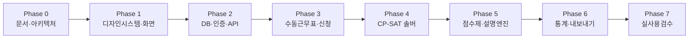

# 단계별 구현 계획 (IMPLEMENTATION_PLAN)

> 상태: **Phase 0 확정 v0.1** · 근거: [MASTER_PROMPT.md](../MASTER_PROMPT.md) §1, §14

---

## 1. 개요 및 진행 원칙

각 단계(Phase 0~7)는 **구현 $\rightarrow$ 테스트 $\rightarrow$ 시각 검수 $\rightarrow$ 결과 보고**를 완료한 후 다음 단계로 진행한다.

---

## 2. Phase별 상세 작업 및 완료 기준

### Phase 0 — 요구사항 및 아키텍처 문서화 (현재 단계)
- **작업 내용:**
  - `docs/` 필수 문서 11종 전체 작성 (규칙, 모델, 아키텍처, QA 기준, 디자인 시스템 등).
  - Git 저장소 초기화 및 기본 커밋.
  - 미확정 정책 항목의 설정 스키마 분리.
- **완료 조건:** 정책 미확정 항목이 코드가 아닌 설정 스키마와 문서로 명시됨.

### Phase 1 — 디자인 시스템 및 클릭 가능한 핵심 화면 (다음 단계)
- **작업 내용:**
  - Vite + React 19 + TypeScript 프로젝트 셋업.
  - CSS Variables 토큰 시스템 구축 (`tokens.css`, `base.css`).
  - 재사용 Compound 컴포넌트(`RosterGrid`, `Calendar`, `ShiftCell`, `BottomSheet` 등) 구현.
  - 우선 구현 6개 화면 목업(Mock) 구현 및 클릭 인터랙션 검증.
- **완료 조건:** 390px(모바일), 768px(태블릿), 1280px(PC) 반응형 레이아웃 정상 동작, 스크린샷 검증 보고.

### Phase 2 — 데이터베이스, 인증 및 백엔드 API
- **작업 내용:**
  - FastAPI 프로젝트 구성, SQLAlchemy 2.0 모델 및 Alembic 마이그레이션.
  - 6명 가상 간호사 및 병동 시드 데이터 생성.
  - 근무 템플릿, 정책, 신청, 근무표 CRUD API 엔드포인트 구현.
- **완료 조건:** SQLite DB 저장/조회 단위 테스트 통과, OpenAPI 자동 생성 확인.

### Phase 3 — 수동 근무표 편집 및 오프 신청 워크플로
- **작업 내용:**
  - `RosterGrid` 실시간 편집기(셀 선택, 키보드 이동, 복사/붙여넣기, Undo/Redo).
  - 실시간 서버 측 제약 검증(하드 에러 vs 소프트 경고).
  - 모바일 오프 신청 2단계 플로우 및 상태 전이.
- **완료 조건:** 6명 한 달 편성 수동 작성/저장 및 간호사 캘린더 반영 E2E 검증.

### Phase 4 — 제약 최적화 엔진 (OR-Tools CP-SAT)
- **작업 내용:**
  - CP-SAT 모델링(H-COV, H-REST 11h, H-CONSEC 5d, H-WEEK 52h, H-LEAVE).
  - 사전 실현가능성 검사 및 `INFEASIBLE` 진단기 구현.
  - 후보안 2~3개 자동 생성 및 그리드 적용 API.
- **완료 조건:** FEASIBLE/INFEASIBLE 시나리오 단위 테스트 통과.

### Phase 5 — 5단계 점수제 및 설명 엔진
- **작업 내용:**
  - `Decimal` 기반 5단계 점수 계산 파이프라인.
  - 26.5점 및 A=35점/B=26점 필수 수치 테스트.
  - 3개월 롤링 이월 및 설명 엔진(`explanation_facts`).
- **완료 조건:** QA_CHECKLIST 수치 검증 100% 일치.

### Phase 6 — 통계, 내보내기 및 운영 보강
- **작업 내용:**
  - 공정성 통계 차트(야간시간 막대, 주말 편차).
  - Excel(XLSX) 및 CSV 공식 서식 내보내기.
  - 9가지 상태 UX 최종 점검.
- **완료 조건:** 한 달 전체 자동편성 $\rightarrow$ 검토 $\rightarrow$ 확정 $\rightarrow$ 엑셀 내보내기 완주.

### Phase 7 — 실사용 검수 준비
- **작업 내용:**
  - 병원 법무/인사 협의 체크리스트 완성 및 운영 차단 목록 정리.
- **완료 조건:** 운영 이관 패키지 완성.
