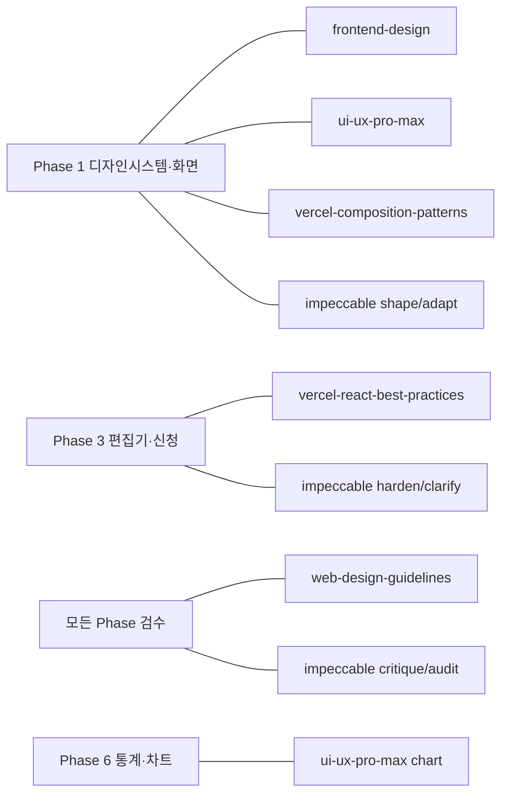

# 스킬셋 정리 (SKILL_SET)

> 프로젝트: 산부인과 병동 근무 스케줄러
> 설치 위치: `nurse/.agents/skills/` (이 프로젝트 전용, 전역 설정 변경 없음)
> 설치일: 2026-11-01 · 기준 문서: [MASTER_PROMPT.md](../MASTER_PROMPT.md) §2
> 이 문서는 **설치된 스킬 목록과 사용 계획**이다. 실제로 어떤 화면에 어떤 규칙을 적용했는지는 Phase 1부터 `docs/SKILL_APPLICATION.md`에 기록한다.

---

## 1. 설치 내역 (출처 · 버전 고정)

| 스킬 (`name`) | 설치 경로 | 공식 출처 | 커밋 | 라이선스 | 파일 수 |
|---|---|---|---|---|---|
| `frontend-design` | `.agents/skills/frontend-design` | github.com/anthropics/skills → `skills/frontend-design` | `ca45fc4` | LICENSE.txt 동봉 | 2 |
| `ui-ux-pro-max` | `.agents/skills/ui-ux-pro-max` | github.com/nextlevelbuilder/ui-ux-pro-max-skill → `.claude/skills/ui-ux-pro-max` | `9a3f14f` | MIT | 74 |
| `web-design-guidelines` | `.agents/skills/web-design-guidelines` | github.com/vercel-labs/agent-skills → `skills/web-design-guidelines` | `1a2c79d` | (vercel 저자 명시) | 1 |
| `vercel-react-best-practices` | `.agents/skills/vercel-react-best-practices` | github.com/vercel-labs/agent-skills → `skills/react-best-practices` | `1a2c79d` | MIT | 76 |
| `vercel-composition-patterns` | `.agents/skills/vercel-composition-patterns` | github.com/vercel-labs/agent-skills → `skills/composition-patterns` | `1a2c79d` | MIT | 14 |
| `impeccable` (v4.8.0) | `.agents/skills/impeccable` | github.com/pbakaus/impeccable → `.agents/skills/impeccable` | `2f97a85` | Apache-2.0 | 64 |

전체 커밋 해시:
- anthropics/skills `ca45fc496a3436251f191354091d557da31c15b5`
- nextlevelbuilder/ui-ux-pro-max-skill `9a3f14f7423037ccb8feeb4fee7482291b9c820e`
- vercel-labs/agent-skills `1a2c79d4e6c4a2283dc2c614b6538cbe1ed5ca62`
- pbakaus/impeccable `2f97a85a4a87a80066a693bd3546b092bd300772`

---

## 2. 스킬별 요약과 이 프로젝트에서의 사용 방법

### 2-1. `frontend-design` — 시각적 방향 설정
- **무엇:** 템플릿처럼 보이는 디자인을 피하고, 주제에 맞는 의도적인 팔레트·타이포·레이아웃을 정하게 하는 가이드.
- **핵심 규칙:**
  - 코딩 전에 2단계로 진행한다: ① 토큰 계획(색 4–6개 hex, 서체 역할, 레이아웃 ASCII 와이어프레임, 원칙) ② 계획이 "어디서나 나올 기본값"인지 자기검토 후 수정.
  - AI 생성 디자인에서 흔한 기본값을 피한다: 크림 배경+테라코타, 똑같은 둥근 카드+회색 그림자, ALL-CAPS eyebrow 라벨, `→` 붙은 버튼 등.
  - 대담함은 한 곳에만 쓴다. 반응형·포커스·reduced motion은 기본으로 지킨다.
  - UI 문구: 사용자 관점, 능동태, 버튼 이름과 결과 토스트 일치("발행" → "발행됨"), 사과하지 않는 구체적 오류 문구.
- **적용 시점:** Phase 1 디자인 토큰 수립(`docs/DESIGN_SYSTEM.md`), 화면 문구 작성.
- **⚠ 조정:** 이 스킬은 "미학적 모험"을 권장하지만, MASTER_PROMPT §4는 **차분하고 신뢰감 있는 임상 업무 UI**를 지정한다. 스킬 자체에도 "브리프가 이긴다"고 되어 있으므로 MASTER_PROMPT 방향을 따르고, 차별화는 정보 위계·타이포그래피·근무 칩 설계로만 한다.

### 2-2. `ui-ux-pro-max` — UX 규칙 DB + 디자인 시스템 검색
- **무엇:** 오프라인 CSV 데이터(스타일 79, 팔레트 192, 폰트 페어 74, UX 가이드라인 119, 차트 25, 스택 22)를 검색하는 Python 스크립트와 우선순위 규칙표.
- **우선순위 규칙 (이 프로젝트 핵심):** ① 접근성(대비 4.5:1, 키보드, aria) ② 터치(44×44, 8px 간격, 로딩 피드백) ③ 성능(CLS) ⑤ 반응형(가로 스크롤 금지, 줌 허용) ⑥ 타이포(본문 16px, 행간 1.5, 시맨틱 색 토큰) ⑧ 폼(보이는 라벨, 필드 옆 오류) ⑨ 내비게이션(하단 탭 ≤5) ⑩ 차트(색만으로 의미 전달 금지).
- **사용 명령 (설치 경로 기준 — 원문의 `${CLAUDE_PLUGIN_ROOT}` 경로는 이 환경에 해당 없음):**
  ```powershell
  $env:PYTHONIOENCODING="utf-8"
  python .agents\skills\ui-ux-pro-max\scripts\search.py "healthcare scheduling dashboard calm" --design-system -p "Ward Scheduler"
  python .agents\skills\ui-ux-pro-max\scripts\search.py "touch target size" --domain ux
  python .agents\skills\ui-ux-pro-max\scripts\search.py "table sticky header keyboard" --stack react
  ```
- **검증:** 2026-11-01 `"touch target size" --domain ux` 실행 → 정상 결과 2건 반환 확인. 외부 의존성·네트워크 호출 없음(스크립트 정적 검사).
- **적용 시점:** Phase 1 디자인 시스템 생성, 각 화면 UX 점검, 차트 선택(Phase 6), 납품 전 `references/pro-rules.md` 체크리스트.
- **⚠ 주의:** 검색 결과는 권고일 뿐, 0건이면 지어내지 않고 "기본값 사용"이라고 명시한다. `--persist --force`는 사용자 승인 없이 쓰지 않는다. 쿼리에 실제 병원 데이터를 넣지 않는다.

### 2-3. `web-design-guidelines` — UI 코드 감사 (Vercel)
- **무엇:** Vercel Web Interface Guidelines 기준으로 UI 파일을 검사해 `file:line` 형식으로 지적하는 리뷰 스킬. 접근성, 포커스, 시맨틱 요소, 폼, 반응형, 오류 처리 등을 다룬다.
- **동작:** 검사할 때마다 최신 규칙을 `https://raw.githubusercontent.com/vercel-labs/web-interface-guidelines/main/command.md`에서 가져온다 → **네트워크 필요**.
- **적용 시점:** 각 Phase의 시각 검수 단계에서 `frontend/src/**` 대상 감사. 특히 `RosterGrid` 표 접근성(`<table>`/`<th scope>`/키보드 이동), 상태 안내(`aria-live`), 포커스 링.
- **⚠ 주의:** 원격 규칙은 바뀔 수 있으므로 검사할 때마다 가져온 규칙 파일의 날짜/내용 요약을 `SKILL_APPLICATION.md`에 남긴다. 오프라인일 경우 "미실행"으로 표시한다.

### 2-4. `vercel-react-best-practices` — React 성능 규칙 70개
- **무엇:** 8개 범주, 영향도순 정렬된 React/Next.js 성능 규칙 (`rules/*.md` 각각 나쁜 예/좋은 예 포함).
- **이 프로젝트(Vite SPA)에 적용하는 규칙:**
  | 범주 | 적용 규칙 예 | 어디에 |
  |---|---|---|
  | 워터폴 제거 | `async-parallel`, `async-defer-await` | 근무표+신청+정책 병렬 조회 |
  | 번들 | `bundle-barrel-imports`, `bundle-conditional`, `bundle-preload` | 관리자 화면·차트·XLSX 지연 로딩 |
  | 클라이언트 페칭 | `client-swr-dedup`(→ TanStack Query로 동일 원칙), `client-localstorage-schema` | 서버 상태 캐시, localStorage는 UI 설정만 |
  | 리렌더 | `rerender-memo`, `rerender-derived-state-no-effect`, `rerender-no-inline-components`, `rerender-transitions` | 31일×N명 `RosterGrid` 셀 렌더 최소화 |
  | 렌더링 | `rendering-content-visibility`, `rendering-conditional-render` | 긴 목록, 조건부 렌더 |
  | JS | `js-index-maps`, `js-set-map-lookups` | `(staffId, date)` → 배정 Map 조회 |
- **적용하지 않는 규칙:** `server-*`, `bundle-dynamic-imports(next/dynamic)`, `rendering-hydration-*` 등 Next.js/RSC 전용 규칙 → **Vite SPA라 해당 없음**(MASTER_PROMPT §2 "현재 React 버전에 맞지 않는 지침은 근거를 남겨라"). React 19 `Activity` 등은 버전 확인 후 적용.

### 2-5. `vercel-composition-patterns` — 컴포넌트 API 설계
- **무엇:** boolean prop 남발 대신 합성(compound component, provider, 명시적 variant)으로 확장성 있는 컴포넌트를 만드는 규칙 8개.
- **규칙:** `architecture-avoid-boolean-props`, `architecture-compound-components`, `state-decouple-implementation`, `state-context-interface`(state/actions/meta), `state-lift-state`, `patterns-explicit-variants`, `patterns-children-over-render-props`, `react19-no-forwardref`.
- **이 프로젝트 적용 설계 (MASTER_PROMPT §2 지정 컴포넌트):**
  ```tsx
  <RosterGrid.Provider period={period} mode="edit">   // 상태는 Provider만 앎
    <RosterGrid.Toolbar />                              // Undo/Redo, 저장 상태
    <RosterGrid.Table>
      <RosterGrid.DateHeader />                         // 고정 헤더, 요일·공휴일
      <RosterGrid.StaffRows>{(staff) => <RosterGrid.Row staff={staff} />}</RosterGrid.StaffRows>
      <RosterGrid.CoverageFooter />                     // 일자별 인원/자격 충족 배지
    </RosterGrid.Table>
  </RosterGrid.Provider>
  ```
  - `isEditable`, `isMobile`, `showCoverage` 같은 boolean 대신 `RosterGrid.ViewTable` / `RosterGrid.EditTable` 같은 명시적 variant.
  - `ShiftCell`은 템플릿 객체(코드·라벨·색 토큰)를 받아 렌더 — D/N 하드코딩 없음.
  - `Calendar`, `RequestCard`, `ConflictPanel`, `BottomSheet`도 같은 원칙.
- **적용 시점:** Phase 1 컴포넌트 구현, 이후 모든 컴포넌트 리뷰.

### 2-6. `impeccable` (v4.8.0) — 디자인 비평·감사·다듬기
- **무엇:** 디자인 디렉터 관점의 명령 모음. 이 프로젝트는 **Operate 모드**(앱 UI·관리자·설정)에 해당 → 표현보다 스캔성·일관성·익숙한 패턴 우선, 브랜드는 정밀한 디테일로만.
- **이 프로젝트에서 쓸 명령:**
  | 명령 | 용도 | Phase |
  |---|---|---|
  | `shape` | 화면 UX 계획(코드 전) | 1 |
  | `init` / `document` | `PRODUCT.md` / `DESIGN.md` 작성 | 0–1 |
  | `critique` | 휴리스틱 UX 리뷰 | 각 Phase 검수 |
  | `audit` | 접근성·성능·반응형 기술 점검 | 각 Phase 검수 |
  | `harden` | 오류·엣지 케이스·상태 9종 | 3, 6 |
  | `clarify` | 한국어 UI 문구·오류 메시지 | 전 Phase |
  | `adapt` | 320/390/768/1280 대응 | 1 |
  | `layout`, `typeset`, `polish` | 간격·타이포·최종 다듬기 | 1, 6 |
- **사용하지 않을 명령:** `bolder`, `overdrive`, `delight`, `animate`(과한 연출) — MASTER_PROMPT "장식보다 명료함" 원칙과 충돌. `live`/`generate`(브라우저에 스크립트 주입하는 라이브 모드)는 필요 시 승인 후.
- **⚠ 보안 주의:** 스킬의 Setup 단계(`scripts/impeccable context`)는 **처음 실행 시 GitHub Releases에서 네이티브 실행 파일(`impeccable-windows-*.exe`)을 내려받아 실행**한다(`scripts/impeccable.cmd` 113행). MASTER_PROMPT §2("출처가 모호한 스킬 파일을 무검증 실행하지 마라")에 따라 **사용자 승인 전에는 실행하지 않는다.** 승인이 없으면 스킬이 정한 대체 경로("Launcher unavailable" → `PRODUCT.md`/`DESIGN.md`와 `reference/*.md`를 직접 읽고 진행)를 사용한다. `reference/craft-floor.md`는 UI 수정 직전에 반드시 읽는다.

---

## 3. 스킬 간 충돌 시 우선순위

MASTER_PROMPT §2 규칙: **사용자 안전/접근성/업무 정확성 > 컴포넌트 구조/성능 > 미학**

| 충돌 상황 | 결정 |
|---|---|
| `frontend-design`의 "대담한 미학" vs MASTER_PROMPT의 "차분한 임상 UI" | MASTER_PROMPT 우선 (두 스킬 모두 "브리프가 이긴다"고 명시) |
| 터치 타겟: `ui-ux-pro-max`(웹 WCAG 24px / iOS 44pt) vs MASTER_PROMPT(44×44) | **44×44px** 채택 (더 엄격한 쪽, 간호사 현장 사용) |
| `impeccable` 라이브 모드/바이너리 vs 보안 원칙 | 승인 전 미실행, 문서 기반 대체 경로 |
| `vercel-react-best-practices`의 Next.js 전용 규칙 | Vite SPA라 미적용, 사유 기록 |
| 그리드 성능(memo 등) vs 접근성(표 시맨틱) | 시맨틱 `<table>` 유지, 성능은 그 안에서 최적화 |

---

## 4. Phase별 스킬 적용 지도



| Phase | 주 적용 스킬 |
|---|---|
| 0 문서 | `impeccable init`(PRODUCT.md 구조 참고), `frontend-design`(토큰 계획) |
| 1 디자인 시스템·핵심 화면 | `frontend-design`, `ui-ux-pro-max --design-system`, `vercel-composition-patterns`, `impeccable shape/adapt/typeset` |
| 2 DB·API | (프론트 스킬 해당 없음) — API 타입 경계만 `vercel-react-best-practices` 페칭 규칙 |
| 3 수동 편성·신청 | `vercel-react-best-practices`(그리드 리렌더), `impeccable harden/clarify` |
| 4–5 엔진·설명 | 설명 패널 UI에 `impeccable clarify`, `ui-ux-pro-max`(폼·피드백) |
| 6 통계·내보내기 | `ui-ux-pro-max --domain chart`, `impeccable polish` |
| 모든 Phase 검수 | `web-design-guidelines`, `impeccable critique/audit` |

---

## 5. 운영 규칙

1. 스킬은 이름만 언급하지 않고 **해당 SKILL.md와 필요한 rules/reference 파일을 실제로 읽은 뒤** 적용한다.
2. 적용 결과는 `docs/SKILL_APPLICATION.md`에 `화면 / 사용한 규칙 ID / 변경 사항 / 미적용 사유` 형식으로 남긴다.
3. 스킬 업데이트는 위 커밋 해시와 비교한 뒤 진행하고, 이 문서의 표를 갱신한다.
4. 네트워크가 필요한 작업(`web-design-guidelines` 규칙 가져오기, `impeccable` 바이너리)은 실행 여부를 명시하고, 실행 못 하면 `미실행`으로 표시한다.
